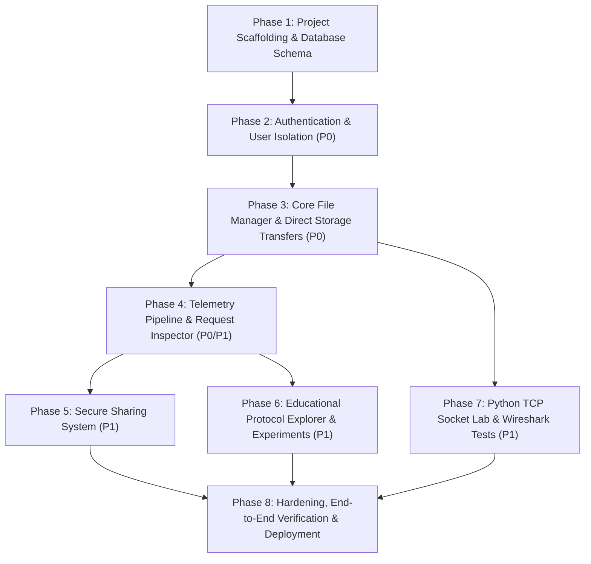

# NetShare: Development Phases & Implementation Plan

> **Document Status:** Implementation Roadmap  
> **Source PRD:** `NetShare_PRD_and_Implementation_Plan.docx`  
> **Target Stack:** Next.js (TypeScript, App Router, Tailwind CSS, shadcn/ui), Supabase (Auth, Postgres, Storage), Python 3 (TCP Socket Lab), Wireshark.

---

## 1. Executive Summary & Architecture Overview

**NetShare** is a multi-user web-based network file server, network protocol explorer, and TCP socket laboratory built for a Computer Networks project. It bridges the gap between conventional file management and low-level networking observability.

### Dual-Architecture Model:
1. **Managed Web Application (Next.js + Supabase on Vercel):**
   - High-level HTTPS/HTTP file sharing, direct-to-storage transfers, metadata management, telemetry logging, and educational protocol inspection.
   - Strict Row Level Security (RLS) and storage isolation across multiple authenticated users.
2. **Advanced TCP Protocol Lab (`tcp-lab/` in Python):**
   - Runs locally or on a local testbed to demonstrate low-level socket programming, binary message framing (`NSHR` protocol), handling partial reads/stream fragmentation, bounded payloads, and SHA-256 integrity verification.
   - Produces reproducible packet captures for Wireshark analysis (TCP 3-way handshake, sequence/ACK numbers, teardown, retransmission behavior).

---

## 2. Requirement Matrix & Priority Mapping

| ID | Requirement | Priority | Module | Acceptance Summary |
| :--- | :--- | :---: | :--- | :--- |
| **FR-01** | Authentication | **P0** | Web App | Sign-up, Sign-in, Sign-out, secure session persistence. |
| **FR-02** | File Upload | **P0** | Web App / Storage | Direct authorized upload to private Supabase Storage. |
| **FR-03** | File Listing & Search | **P0** | Web App | User lists, sorts, filters, and navigates only their own files/folders. |
| **FR-04** | Download & Integrity | **P0** | Web App | Authorized download with client-side SHA-256 verification. |
| **FR-05** | Rename & Delete | **P0** | Web App / Storage | Owners can rename and delete objects with partial failure recovery. |
| **FR-06** | Metadata Management | **P0** | Postgres / API | Strict relational schema storing owner, object path, MIME, size, checksum. |
| **FR-07** | Telemetry Logging | **P0** | Web App / API | Real-time monotonic timing, byte counting, status codes, request IDs. |
| **FR-08** | Network Dashboard | **P0** | Web App | Aggregates transfer totals, throughput, error rates, and duration graphs. |
| **FR-09** | Request Inspector | **P1** | Web App | Detailed inspector modal showing HTTP method, URL, headers, timing, errors. |
| **FR-10** | TCP Socket Lab | **P1** | Python Lab | Custom framed protocol over TCP (`NSHR`), chunk transfer, error states. |
| **FR-11** | SHA-256 Verification | **P0** | Both | Independent digest calculation validating transferred files byte-for-byte. |
| **FR-12** | Expiring Share Links | **P1** | Web App / API | Cryptographically secure tokens, expiration, revocation, guest download. |
| **FR-13** | Experiment History | **P1** | Web App / API | Save, list, and compare multi-run transfer tests under varying payload sizes. |
| **FR-14** | Range/Resume Download | **P2** | Web App (Opt) | Optional HTTP Range verification if storage provider supports it. |

---

## 3. Phased Implementation Roadmap



---

### Phase 1: Project Scaffolding, Core Infrastructure & Database Schema
**Goal:** Initialize the Next.js application, configure toolchains, establish Supabase connections, and apply the database schema with Row Level Security (RLS).

- **1.1 Next.js Application Initialization:**
  - Create Next.js project with TypeScript, Tailwind CSS, ESLint, App Router (`src/app`).
  - Install dependencies: `@supabase/ssr`, `@supabase/supabase-js`, `lucide-react`, `recharts`, `clsx`, `tailwind-merge`, and UI primitives.
  - Set up path aliases (`@/*`).
- **1.2 Database Schema & Migrations (`supabase/migrations/`):**
  - Create table `public.folders` (hierarchical folders with `parent_folder_id`, `owner_id`).
  - Create table `public.files` (metadata: `storage_path`, `size_bytes`, `mime_type`, `checksum_sha256`, `owner_id`, `folder_id`).
  - Create table `public.shares` (`token_hash`, `expires_at`, `revoked_at`, `file_id`, `owner_id`).
  - Create table `public.transfer_logs` (`request_id`, `operation`, `status_code`, `duration_ms`, `bytes_transferred`, `error_code`, `user_id`).
  - Create table `public.experiments` (`experiment_type`, `parameters`, `results`, `user_id`).
  - Add database indexes for query performance (`(owner_id, created_at desc)`, etc.).
- **1.3 Row Level Security (RLS) & Storage Policies:**
  - Enable RLS on all tables.
  - Implement RLS policies ensuring users can only read, insert, update, and delete their own rows (`auth.uid() = owner_id`).
  - Configure Supabase Storage bucket `netshare-files` as **Private**.
  - Apply storage policies allowing authenticated users to upload and read only objects prefixed by their own `auth.uid()`.
- **1.4 Core Libraries & Types:**
  - `src/lib/supabase/client.ts` (browser client).
  - `src/lib/supabase/server.ts` (server component / Route Handler client).
  - `src/lib/supabase/middleware.ts` (session refresh).
  - `src/types/database.ts` and `src/types/netshare.ts`.
  - Checksum utility `src/lib/crypto/sha256.ts` (Web Crypto API SHA-256 for browser).

**Deliverables & Checkpoint:**
- [x] Working Next.js baseline compiling cleanly.
- [x] Schema SQL migration file ready to apply to Supabase.
- [x] Environment template (`.env.example`) defined with public keys only.

---

### Phase 2: Authentication & User Isolation (P0)
**Goal:** Implement secure authentication and prove strict cross-user isolation.

- **2.1 Auth Route Handlers & State Management:**
  - Auth routes: Sign up with email/password, Sign in, Sign out, Password reset.
  - Supabase Auth callback handler (`/api/auth/callback`).
  - Route middleware protecting `/(dashboard)` and redirecting unauthenticated visitors to `/(auth)/login`.
- **2.2 Auth Pages & UI:**
  - `/(auth)/login/page.tsx` & `/(auth)/register/page.tsx` with clean, responsive form validation.
  - Session header component with user avatar, email, and sign-out action.
- **2.3 Isolation Verification (Test T-01 & T-03 Baseline):**
  - Verify two separate test users (`user_a@test.com`, `user_b@test.com`).
  - Ensure session cookies are secure, HTTP-only where appropriate, and no service-role secrets leak to the client.

**Deliverables & Checkpoint:**
- [x] Working sign-up, sign-in, and sign-out flows.
- [x] Middleware route protection for all dashboard views.

---

### Phase 3: Core File Management & Direct Storage Transfers (P0)
**Goal:** Deliver a production-grade file manager supporting direct-to-storage uploads, downloads, folder organization, search, and integrity verification.

- **3.1 Direct-to-Storage Upload Pipeline:**
  - Browser calculates file SHA-256 digest using chunked streaming (`crypto.subtle.digest`) without loading entire large files into memory.
  - Upload file directly to Supabase Storage path `<user-id>/<uuid>-<filename>`.
  - Monotonic timer (`performance.now()`) records precise transfer duration.
  - On upload success, call `POST /api/files` to register database metadata.
  - Partial failure handling: if metadata registration fails after object upload, trigger cleanup or record partial status.
- **3.2 File Download Pipeline & Integrity Verification:**
  - Generate authorized download URL (via Supabase storage signed URL or authorized client download).
  - Measure download latency, transfer duration, and observed bytes.
  - Verify received file against expected `checksum_sha256`.
  - Provide visual integrity badge (Green check for matching digest, Red alert for mismatch).
- **3.3 File Management UI (`src/app/(dashboard)/files`):**
  - Breadcrumb navigation supporting hierarchical folders.
  - Grid view & List view toggle.
  - Sorting (by name, size, date, type) and real-time search filter.
  - Create folder modal, rename file/folder modal, delete confirmation modal.
  - File details drawer showing storage path, MIME type, size, SHA-256 hash, and upload timestamp.
- **3.4 File Operations API Routes (`/api/files`):**
  - `GET /api/files`: list files with pagination (`cursor`/`limit`), search query (`q`), and folder filtering (`folderId`).
  - `POST /api/files`: validate and record file metadata (derive owner from session).
  - `PATCH /api/files/:id`: rename file or move to folder (validate folder ownership).
  - `DELETE /api/files/:id`: delete file metadata and remove object from storage.

**Deliverables & Checkpoint:**
- [x] Files and folders can be created, uploaded, downloaded, renamed, and deleted.
- [x] Upload and download measure real transfer time and verify SHA-256.
- [x] User B cannot view or download User A's files (passes tests T-02, T-03, T-04, T-05).

---

### Phase 4: Telemetry Pipeline & Request Inspector (P0 / P1)
**Goal:** Capture real application-level HTTP metrics and display them in an interactive network dashboard and request inspector.

- **4.1 Telemetry Client Service (`src/lib/telemetry`):**
  - Standardized instrumentation wrapper around `fetch`:
    - Generate unique UUID `requestId`.
    - Record monotonic timestamp start/end using `performance.now()`.
    - Capture method, endpoint, status code, request/response headers (e.g. `content-length`, `content-type`).
    - Capture error codes and failure points.
  - Telemetry event dispatcher (`POST /api/telemetry`).
- **4.2 Telemetry API Routes:**
  - `POST /api/telemetry`: persist operation log to `transfer_logs` table (user ID bound from session).
  - `GET /api/telemetry`: fetch recent operations for current user with filter (operation, status).
  - `GET /api/telemetry/summary`: calculate aggregates (total transfers, total bytes, average duration, effective throughput in MiB/s, error rate).
- **4.3 Network Activity Dashboard (`src/app/(dashboard)/network`):**
  - Summary metric cards: Total Bytes Transferred, Completed Transfers, Average Throughput (MiB/s), Error Rate (%).
  - Throughput vs. File Size chart (Recharts line/scatter chart).
  - Operation duration latency chart.
  - Live activity feed showing recent transfer events with status badges.
- **4.4 Request Inspector Drawer (`src/components/request-inspector`):**
  - Click any logged transfer or file operation to open detailed inspector:
    - HTTP Method & Status Badge (`200 OK`, `201 Created`, `401`, `403`, `404`, `500`).
    - Request ID, Timestamp, Duration (`XX ms`).
    - Observable HTTP Headers (Request & Response).
    - Effective throughput calculation breakdown (`Bytes / Seconds = MiB/s`).
    - Explicit explanation of browser observability boundaries (clarifying that raw TCP ACK/SYN are transport-layer and inspected in the lab).

**Deliverables & Checkpoint:**
- [x] Every file transfer automatically records real telemetry.
- [x] Network dashboard displays live metrics and Recharts visualizations.
- [x] Request inspector explains individual HTTP transactions (passes tests T-07, T-08).

---

### Phase 5: Secure File Sharing System (P1)
**Goal:** Enable secure, revocable, and expiring file share links without exposing permanent public storage URLs.

- **5.1 Cryptographic Token Architecture:**
  - Generate cryptographically secure random token (32 bytes hex) on client/server.
  - Store only the SHA-256 hash (`token_hash`) in the database; never store raw share tokens.
  - Configurable expiration options (1 hour, 24 hours, 7 days).
- **5.2 Share API Endpoints (`/api/shares`):**
  - `POST /api/shares`: create share record, returns raw token once to owner.
  - `POST /api/shares/:token/redeem`: public/guest endpoint. Hashes input token, checks expiry (`expires_at > now()`) and revocation (`revoked_at is null`), and generates a short-lived (e.g., 60s) signed storage URL.
  - `DELETE /api/shares/:id`: owner revokes the share by setting `revoked_at = now()`.
- **5.3 Share UI & Public Access Page:**
  - Share modal in File Manager: select expiry, generate shareable link, copy to clipboard.
  - Shares management list: view active shares, see remaining time, revoke access.
  - Public share redemption view (`/share/[token]`): displays file metadata (name, size), download button, and countdown to link expiration.

**Deliverables & Checkpoint:**
- [x] Secure links can be shared, downloaded before expiry, and blocked after revocation/expiration.
- [x] No storage bucket credentials or service keys exposed.

---

### Phase 6: Educational Protocol Explorer & Experiments (P1)
**Goal:** Create an interactive educational suite illustrating the networking protocol stack and run controlled HTTP transfer experiments.

- **6.1 Protocol Explorer UI (`src/app/(dashboard)/protocols`):**
  - Interactive multi-layer visualization:
    - **Layer 7 (Application):** HTTP/1.1 vs HTTP/2 vs HTTP/3, headers, status codes, REST semantics.
    - **Layer 6 (Security):** TLS 1.3 handshake, encryption, public key certificates, HTTPS.
    - **Layer 4 (Transport):** TCP (ordered, reliable, 3-way handshake) vs UDP / QUIC (datagram, multiplexed).
    - **Layer 3 (Network):** IP addressing, routing, packet fragmentation, TTL.
    - **Application to Network mapping:** Explaining DNS resolution, connection reuse, and browser timing API limits.
- **6.2 Controlled Experiment Suite (`src/app/(dashboard)/lab`):**
  - Generate dummy test payloads on demand (100 KB, 1 MB, 5 MB, 10 MB, 25 MB).
  - Execute multi-run transfers (e.g., 3 runs per size) measuring transfer duration, effective throughput, and integrity.
  - Display comparative analysis table and charts (Overhead impact on small vs large payloads).
  - Save experiment runs to `experiments` table (`POST /api/experiments`) and load history (`GET /api/experiments`).

**Deliverables & Checkpoint:**
- [x] Interactive protocol explorer explaining networking concepts with visual aids.
- [x] Experiment runner generating real throughput datasets for report and viva.

---

### Phase 7: Advanced Python TCP Socket Lab (P1)
**Goal:** Implement a custom binary-framed file transfer protocol directly over TCP sockets in Python to demonstrate transport-layer mechanics, message framing, stream fragmentation handling, and Wireshark capture.

- **7.1 Custom Binary Frame Protocol (`tcp-lab/protocol.py`):**
  - **10-byte fixed header format:**
    ```
    +-------------------+---------------+-------------------+---------------------+
    | Magic (4 bytes)   | Version (1B)  | Msg Type (1 Byte) | Payload Length (4B) |
    | "NSHR" (ASCII)    | 0x01          | 0x01-0x06         | Big-Endian uint32   |
    +-------------------+---------------+-------------------+---------------------+
    | Payload: 0 to 65,536 bytes (JSON metadata or raw file bytes)                    |
    +---------------------------------------------------------------------------------+
    ```
  - **Message Types:**
    - `0x01 HELLO`: Client/server capability handshake.
    - `0x02 FILE_START`: JSON metadata (`filename`, `total_bytes`, `expected_sha256`).
    - `0x03 FILE_CHUNK`: Raw chunk (max 64 KiB per frame).
    - `0x04 FILE_END`: End-of-file notification.
    - `0x05 ACK`: Acknowledgment containing transfer status and verified checksum.
    - `0x06 ERROR`: Error code and message.
  - **Stream Framing Utility (`recv_exact(sock, n)`):**
    - Enforces loop reading until exactly `n` bytes are collected, cleanly handling fragmented TCP buffers.
- **7.2 Robust TCP Server (`tcp-lab/server.py`):**
  - Configurable host (`127.0.0.1` or LAN IP) and port (default `9099`).
  - Strict state machine: `INIT -> HELLO_RECEIVED -> TRANSFERRING -> VERIFYING -> CLOSED`.
  - Stream chunks written to temporary `.tmp` file in dedicated `./storage` folder.
  - Streaming SHA-256 calculation (`hashlib.sha256()`).
  - Atomic rename to final sanitized filename upon matching digest.
  - Defensive security: sanitizes filenames (prevents path traversal), caps max payload length (rejects frames > 64 KiB), caps max total file size (e.g., 100 MB), enforces socket timeouts (10s).
  - Cleans up partial temporary files on client disconnect or checksum failure.
- **7.3 TCP Client & Test Runner (`tcp-lab/client.py`):**
  - Connects to server, performs `HELLO` handshake.
  - Sends `FILE_START`, streams file chunks with `FILE_CHUNK` frames.
  - Sends `FILE_END`, waits for `ACK` response with verification confirmation.
  - Measures transfer duration, computes effective throughput, logs progress.
- **7.4 Edge Case Test Suite (`tcp-lab/test_edge_cases.py`):**
  - Test fragmented headers: sends header 1 byte at a time to prove `recv_exact` robustness (Test T-10).
  - Test oversized frames: sends frame header claiming payload > 64 KiB; asserts server rejects with `ERROR` (Test T-11).
  - Test premature disconnect: client disconnects mid-transfer; asserts server deletes partial file (Test T-12).
  - Test corrupted payload: corrupts 1 byte; asserts checksum mismatch reported.
- **7.5 Wireshark Capture & Packet Analysis Guide (`tcp-lab/WIRESHARK_GUIDE.md`):**
  - Instructions for filtering traffic (`tcp.port == 9099`).
  - Annotations identifying TCP 3-way handshake (`SYN`, `SYN-ACK`, `ACK`), stream data segments, TCP window updates, and connection teardown (`FIN`, `ACK`).
  - Sample capture file (`capture_sample.pcapng`) for demonstration fallback.

**Deliverables & Checkpoint:**
- [x] Complete Python TCP client and server working reliably.
- [x] Robust framing handling fragmentation, timeouts, and corrupted data.
- [x] Wireshark capture verified and documented (passes tests T-09, T-10, T-11, T-12, T-13).

---

### Phase 8: Hardening, End-to-End Verification & Deployment (P0 / P1)
**Goal:** Execute full acceptance testing across all test cases (T-01 to T-14), harden security, build documentation, and prepare for deployment and viva presentation.

- **8.1 Acceptance Testing Checklist Execution:**
  - Execute test suite T-01 through T-14.
  - Negative access-control tests: confirm User B cannot access User A's files via direct API calls or signed paths.
  - Verify zero secrets in client bundles (no `NEXT_PUBLIC_` on secret keys).
- **8.2 Documentation & Presentation Package:**
  - `README.md`: project setup, architecture summary, environment variables, local run instructions.
  - `ARCHITECTURE.md`: complete component diagrams, data flow charts, and security model.
  - `NETWORKING_CONCEPTS.md`: viva preparation guide covering all 12 key networking questions (TCP vs UDP, Framing, DNS Caching, Latency vs Duration, 401 vs 403, etc.).
- **8.3 Deployment Configuration:**
  - Vercel build configuration & environment variable validation.
  - Supabase redirect URLs & CORS whitelist.
  - Production smoke test on public HTTPS URL.

---

## 4. Acceptance Test Mapping (PRD Section 14)

| Test ID | Test Description | Target Phase | Automated / Manual Verification |
| :--- | :--- | :---: | :--- |
| **T-01** | Register and sign in | Phase 2 | Manual / E2E with test accounts. |
| **T-02** | Upload allowed file | Phase 3 | Upload file, confirm storage object & DB record match. |
| **T-03** | Cross-user read isolation | Phase 2, 3 | Sign in as User B, request User A's file ID, assert `403/404`. |
| **T-04** | Cross-user update/delete | Phase 3 | User B attempts `PATCH` / `DELETE` on User A's file, assert denied. |
| **T-05** | Download integrity | Phase 3 | Client downloads file, recomputes SHA-256, matches original. |
| **T-06** | Invalid metadata rejection | Phase 3 | Send malformed payload to `POST /api/files`, assert `400 Bad Request`. |
| **T-07** | Telemetry recording | Phase 4 | Verify `transfer_logs` entry has matching duration, bytes, request ID. |
| **T-08** | Partial failure handling | Phase 3, 4 | Simulate failed metadata save; verify UI alerts partial state. |
| **T-09** | TCP normal transfer | Phase 7 | Run Python client/server; assert exact bytes and matching SHA-256. |
| **T-10** | TCP fragmented header | Phase 7 | Send headers in 1-byte increments; assert successful parse. |
| **T-11** | TCP oversized frame | Phase 7 | Send payload > 64 KiB; assert safe rejection without crash. |
| **T-12** | TCP premature disconnect | Phase 7 | Kill client mid-stream; assert server cleans up temporary file. |
| **T-13** | Wireshark packet capture | Phase 7 | Capture `.pcapng` showing SYN, SYN-ACK, data, FIN/ACK. |
| **T-14** | Production smoke test | Phase 8 | Verify live deployment over HTTPS on Vercel domain. |

---

## 5. Implementation Sequence Summary

When you are ready to begin, we will execute the plan in the following order:

1. **Phase 1:** Scaffold Next.js project, setup Tailwind/shadcn UI, define Supabase migration SQL & RLS policies.
2. **Phase 2:** Build authentication flows, route protection middleware, and user isolation baseline.
3. **Phase 3:** Build direct-to-storage file uploads, SHA-256 hashing, folder navigation, and file actions.
4. **Phase 4:** Build the telemetry logging engine, network dashboard, and request inspector modal.
5. **Phase 5:** Build expiring & revocable share links with guest redemption view.
6. **Phase 6:** Build the protocol explorer educational view and controlled HTTP experiment runner.
7. **Phase 7:** Build the Python TCP socket laboratory (`server.py`, `client.py`, `protocol.py`), edge case test suite, and Wireshark capture guide.
8. **Phase 8:** Run all acceptance tests (T-01 to T-14), write final documentation, and prepare deployment.
