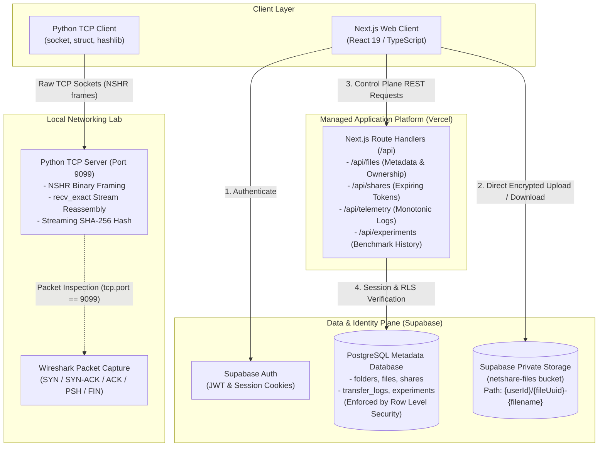
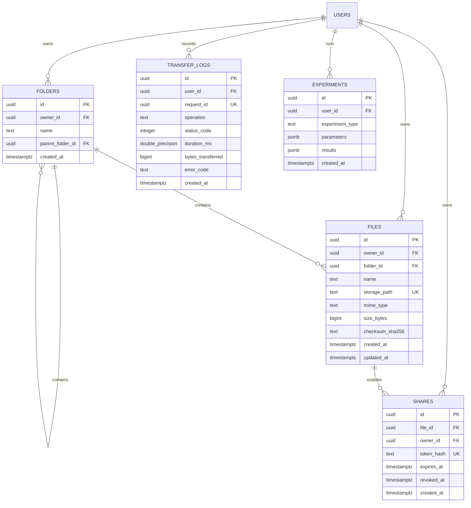

# NetShare: System Architecture & Design Document

> **Project Category:** Computer Networks Mini Project  
> **Deployment Model:** Managed Web Application (Vercel + Supabase) + Standalone Local TCP Socket Lab  
> **Security Model:** Strict Multi-Tenant Row Level Security (RLS) & Object Storage Isolation

---

## 1. High-Level Architecture Overview

NetShare is partitioned into two distinct systems to cleanly separate managed web application concerns from low-level transport layer inspection:



---

## 2. Separation of Data Plane and Control Plane

A foundational design principle in NetShare is that **file payloads never proxy through serverless function runtimes**:

1. **Control Plane (`Next.js Route Handlers` + `PostgreSQL`):**
   - Handles authentication, folder navigation, metadata bookkeeping, share link creation, and telemetry recording.
   - Operates with small JSON payloads (kilobytes).
2. **Data Plane (`Supabase Object Storage`):**
   - Files stream directly between the client and Supabase Storage via signed or authenticated requests.
   - Eliminates function memory exhaustion and Vercel's request payload size limits.

---

## 3. Data Model & Relational Schema



---

## 4. Multi-Tenant Security & Isolation Model

### 1. Database Layer (PostgreSQL RLS)
Every table has Row Level Security enabled:
```sql
create policy "files: owner can read"
  on public.files for select
  to authenticated
  using (owner_id = (select auth.uid()));
```
Clients cannot specify arbitrary `owner_id` values. The identity is always derived server-side from the verified JWT cookie (`auth.uid()`).

### 2. Storage Layer (Bucket Namespace Isolation)
Objects in the `netshare-files` private bucket are prefixed by the owner's UUID:
`{userId}/{fileUuid}-{filename}`

Storage policies enforce that authenticated users can only write, read, or delete objects within their own `{userId}/` path prefix.

### 3. Share Link Token Security
- Raw share tokens are high-entropy (32 cryptographically secure random bytes / 64 hex characters).
- The raw token is returned to the owner exactly once.
- The database stores **only** the SHA-256 hash (`token_hash`) of the token.
- Even in the event of database access leakage, share tokens cannot be derived backwards.
- Share redemption routes verify both expiration (`now() < expires_at`) and revocation (`revoked_at is null`) before emitting a short-lived (60s) signed URL.

---

## 5. Python TCP Socket Lab Protocol (NSHR)

The local TCP laboratory demonstrates stream framing over raw sockets:
- Fixed 10-byte header: `Magic (4B) | Version (1B) | MsgType (1B) | PayloadLength (4B)`
- Maximum payload limit: 64 KiB per frame
- Exact buffer reads: `recv_exact(sock, n)` guarantees loop reading until the full packet is gathered, preventing stream fragmentation failures.
- Defensive isolation: cleans up partial `.tmp` files immediately on client disconnect.
